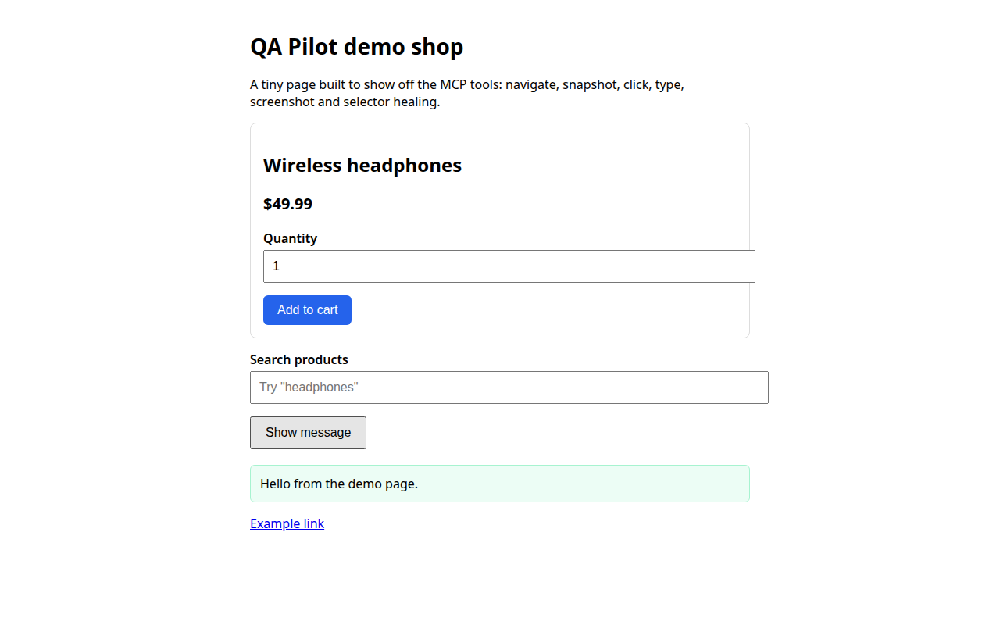

# QA Pilot — an MCP server for Playwright testing

**Let an AI assistant actually test your app.** QA Pilot is a [Model Context Protocol](https://modelcontextprotocol.io/) (MCP) server that gives AI assistants hands on a real browser: navigate, look at the page, click, type, screenshot, read console errors, run real Playwright tests — and heal selectors that broke in the last release.

AI coding assistants can write tests. They can't *run* them against your app, see what broke, and fix it — until now.

## See it working

The demo below is real: `npm run demo` drives the server over stdio against the included demo page. It navigates, snapshots, clicks "Show message", heals a renamed button selector, screenshots, and runs a Playwright spec (2 pass, 1 fails on purpose).



```
=== heal_selector (#checkout-btn — renamed in the last release) ===
{
  "found": true,
  "suggestions": [
    {
      "locator": "page.getByRole('button', { name: 'Add to cart' })",
      "kind": "role",
      "confidence": 0.95,
      "reason": "Role + accessible name — the most resilient locator Playwright recommends."
    }
  ]
}

=== run_playwright_test ===
total 3, passed 2, failed 1 in 7516ms
FAILED: demo.spec.js › search box accepts text (intentionally failing)
  Error: expect(locator).toBeVisible() failed
  at examples/demo.spec.js:28:76
```

Test results — run live, not mocked:

```
npm test
✔ healSelector finds the renamed checkout button by its text
✔ healSelector suggests role+name for an input with an accessible name
✔ healSelector suggests label for an input with a real <label>
✔ healSelector suggests testid for an element with nothing else to grab
✔ healSelector returns found:false when nothing matches
✔ healSelector handles an empty page gracefully
✔ MCP server: list tools, navigate, snapshot, click, type, heal, run test
ℹ tests 8 · pass 8 · fail 0
```

## Tools

| Tool | What it does |
| --- | --- |
| `browser_navigate` | Go to a URL in the shared browser session. Returns title, final URL, HTTP status. |
| `browser_snapshot` | Accessibility snapshot of the page. Every interactive element gets a `[ref=eN]` handle. |
| `browser_click` | Click an element from the last snapshot, by ref. |
| `browser_type` | Type into an input from the last snapshot, by ref. |
| `browser_screenshot` | PNG screenshot of the current page. |
| `browser_evaluate` | Run a JS expression in the page, get JSON back. |
| `browser_console` | Console errors, page errors and failed requests seen so far. |
| `heal_selector` | Fix a broken CSS selector — see below. |
| `run_playwright_test` | Run a real Playwright test file, get structured results. |

Plus one prompt, `qa-smoke-test`, which walks an assistant through smoke-testing a URL step by step.

## Selector healing

The signature feature. A selector usually breaks for a boring reason — an id renamed, a class changed. The healer looks at what's actually on the page right now and ranks replacements the way Playwright's own docs recommend:

```
getByRole  >  getByLabel  >  getByText  >  getByTestId  >  CSS
```

```json
// heal_selector({ selector: "#checkout-btn" }) on a page where the
// button's id is now #checkout-btn-new:
{
  "found": true,
  "suggestions": [{
    "locator": "page.getByRole('button', { name: 'Add to cart' })",
    "kind": "role",
    "confidence": 0.95
  }]
}
```

## Install

```bash
npm install
npx playwright install chromium   # browsers only; the server itself uses playwright-core
```

Node 20+ required.

## Use it

**Claude Desktop** — add to your MCP config:

```json
{
  "mcpServers": {
    "qa-pilot": {
      "command": "node",
      "args": ["/absolute/path/to/qa-pilot-mcp/src/server.js"]
    }
  }
}
```

**VS Code (Copilot)** — add the same server to `.vscode/mcp.json`.

**Try it without any AI client:**

```bash
npm run demo    # full transcript + screenshots/demo.png
npm test        # unit tests + a live stdio end-to-end test
```

Set `PLAYWRIGHT_CHROMIUM_PATH` if your Chromium lives somewhere unusual.

## How it works

```
src/server.js    MCP server (stdio transport) + the qa-smoke-test prompt
src/tools.js     the nine tools: schemas, descriptions, handlers
src/browser.js   one shared Chromium session; aria snapshots with refs
src/healer.js    selector scoring + resilient locator suggestions (pure, tested)
src/runner.js    runs `playwright test --reporter=json`, parses the report
examples/        demo page + demo spec (2 pass, 1 fails on purpose)
test/            healer unit tests + a live stdio integration test
scripts/demo.mjs the transcript generator used for the screenshot above
```

One browser session is shared across tool calls, so an assistant can navigate, look, click and screenshot as one continuous flow — the way a human tester works. Nothing is logged to stdout (stdio is the protocol channel); diagnostics go to stderr.

## Why this exists

Every "AI QA agent" demo ends the same way: the agent writes a test, the test fails on a renamed selector, and a human has to fix it. The missing piece was never the model — it was the tools. QA Pilot is those tools: a browser the agent can drive, a test runner it can invoke, and a healer for the most common failure in UI automation.

## License

MIT.
